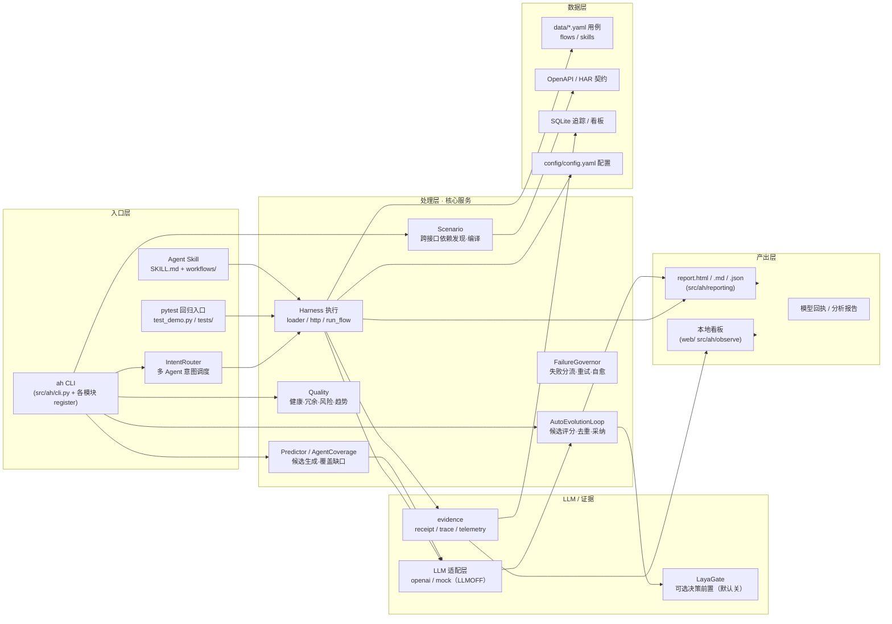

<p align="center">
  <a href="https://img.shields.io/badge/version-0.1.0-blue"></a>
  <a href="LICENSE"></a>
  <a href="https://img.shields.io/badge/Python-3.10%2B-green"></a>
  <a href="https://img.shields.io/badge/status-stable-brightgreen"></a>
</p>

<h1 align="center">Auto API Test Harness</h1>

<p align="center"><strong>面向 Agent 的 API 测试与用例演进框架。</strong></p>

<p align="center"><a href="./README.md">English</a></p>

<p align="center">用 Python、pytest 和 YAML，把接口契约与变更转成可执行用例；<br/>再把回归失败转成诊断证据、复现草稿和待验证的补测候选。</p>

<hr>

## 目录

- [是什么](#是什么)
- [为什么需要](#为什么需要)
- [核心概念](#核心概念)
- [目录结构](#目录结构)
- [架构图](#架构图)
- [快速开始](#快速开始)
- [功能与用法](#功能与用法)
- [配置](#配置)
- [集成与扩展](#集成与扩展)
- [安全边界](#安全边界)
- [FAQ](#faq)
- [路线图](#路线图)
- [贡献指南](#贡献指南)
- [License](#license)
- [维护者](#维护者)

## 是什么

`auto-api-test-harness` 是一个 **面向 Agent 的 API 测试与用例演进框架**。它把「接口契约与变更」转成可执行的 YAML/pytest 用例，再把「回归失败」转成诊断证据、复现草稿和待验证的补测候选。

HTTP 请求、变量传递和业务断言由 Harness 执行；模型可以参与**规划、候选生成、语义诊断或报告分析**。普通回归在 `LLMOFF=1` 下即可离线运行，无需任何模型。

## 为什么需要

手工维护 API 测试用例，在接口变更多、步骤链长、断言复杂时成本极高，且回到失败后难以定位根因。常见痛点：

| 痛点 | 本方案 |
|---|---|
| 用例靠手写，随接口变更经常过时 | 契约（OpenAPI）导入用例骨架 + 覆盖缺口扫描，自动补候选 |
| 失败后只能看到"断言失败"，难以定位 | 失败治理收集断言/状态码/异常，结合规则与失败指纹分流诊断 |
| 补用例靠人肉记忆，容易漏 | Agent Loop 收集失败 → 生成候选 → 评分去重 → 回写演进 |
| 多步骤场景依赖难维护 | 跨接口依赖发现 + 严格场景前置失败阻塞下游并隔离上下文 |
| 回归过程不可观测 | SQLite 追踪 + LLM 用量统计 + 本地看板 + 分能力报告 |

## 核心概念

- **用例（Case）**：一根 YAML 描述的单接口或单断言单元，可含变量、数据集、软断言与重试策略。
- **流程（Flow）**：多步骤场景，支持跨步变量传递、前置依赖与严格失败阻塞。
- **断言（Assertion）**：对响应状态码、JSON 路径（jmespath）等做业务断言，结果进入回执（receipt）。
- **回执（Receipt）**：记录「计划 vs 实际」执行，区分失败/阻塞/跳过/未验证，保留请求、响应与断言证据。
- **进化（Evolution）**：Agent Loop 从失败中生成候选，评分去重后回写 `data/evolution.yaml`，形成持续演进闭环。
- **失败治理（Governance）**：把失败分流到「保留缺陷 / 重跑原步骤 / 尝试修复候选」，支持失败簇与已审核知识复用。
- **Skill**：可复用的 API 能力单元，支持条件、轮询与约定的资源清理。

## 目录结构

```text
auto-api-test-harness-v5/
├── README.md               # 本文件（英文版）
├── README.zh-CN.md         # 中文版
├── pyproject.toml          # 包定义与依赖（uv）
├── uv.lock                 # 锁定依赖版本
├── LICENSE                 # MIT 许可
├── .gitignore              # 排除产物与密钥
├── .gitattributes          # 统一行尾
│
├── src/
│   └── ah/                 # 框架核心包（包名 ah，命令前缀同为 ah）
│       ├── cli.py          # 统一 CLI：挂载各模块子命令并分发
│       ├── core/           # 核心：config 配置 / dispatch 分发 / orchestrator 编排
│       │                   #       / receipt 回执 / variables 变量 / trace 追踪
│       ├── harness/        # 执行 Harness：loader 用例加载 / http 请求
│       │                   #       / registry 用例注册 / 多步场景编排
│       ├── evolution.py    # Agent Loop 与用例演进（evolve / run）
│       ├── failure/        # 失败治理：governor 分流 / triage 诊断
│       │                   #       / cluster 失败簇 / knowledge 知识
│       ├── llm/            # LLM 适配：agents 助手 / openai / mock（LLMOFF）
│       ├── predict/        # 预测与候选生成：generator / risk / assist
│       ├── scenario/       # 跨接口场景：dependencies 发现 / compile 编译
│       ├── coverage/       # 契约覆盖：gap 接口差集 / openapi 导入
│       ├── quality/        # 质量：audit / health / redundancy / lowvalue
│       ├── observe/        # 本地观测：server 看板 / ingest / store / llmdetail
│       ├── skill/          # API Skill：executor / flow / validate
│       ├── reporting/      # 报告：writer（html / md / json）
│       ├── scheduler.py    # 变更驱动 / 计划运行 / 并行调度
│       ├── scaffold.py     # 脚手架：生成独立测试项目
│       └── property.py     # 属性探索（Hypothesis）
│
├── config/
│   └── config.yaml         # 框架配置：基础地址 / LLM / token / 报告目录
├── projects/
│   └── demo/               # 离线示例项目（data / flows / skills / pytest）
├── tests/                  # 框架测试（pytest，默认 LLMOFF 离线）
├── skills/
│   └── auto-api-test-harness/   # Agent 接入 Skill（SKILL.md / references / workflows）
├── docs/                   # 操作指南与设计文档
└── web/                    # 本地看板前端（React）
```

## 架构图

框架按「入口 → 处理 → 数据 → 产出」四层展开，箭头表示主要数据流与控制流。



> 图注：`ah evolve`（离线演进）、`ah add-case`（生成用例）、`ah scenario`（场景发现）、`ah observe`（看板）等命令由各自模块的 `register(subparsers)` 挂载到统一 CLI；`LLMOFF=1` 时 LLM 适配层走 `mock`，全程零网络。

## 快速开始

### 环境要求

- Python 3.10+
- [uv](https://docs.astral.sh/uv/)

### 安装

在仓库根目录：

```bash
uv sync --locked --extra all
```

### 跑离线示例

```bash
LLMOFF=1 AH_LOCAL_OBS=0 AH_TRACE_ENABLED=0 uv run --locked pytest -q -p no:cacheprovider projects/demo
```

预期 **4 passed**。打开 `projects/demo/report/report.html`，同目录还有 `report.md`、`report.json` 和 `run.log`。

单独打印一条健康检查的桩执行结果：

```bash
LLMOFF=1 AH_LOCAL_OBS=0 uv run --locked ah debug demo health-check --stub
```

### 跑框架测试

```bash
LLMOFF=1 AH_LOCAL_OBS=0 AH_TRACE_ENABLED=0 uv run --locked pytest -q -p no:cacheprovider tests projects/demo
```

预期 **698 passed**（当前版本）。

### 构建发布产物

```bash
uv build
# 产出 dist/auto_api_test_harness-<版本>.tar.gz (sdist) 与 -py3-none-any.whl (wheel)
```

## 功能与用法

### Agent Loop 与用例演进

执行用例、收集失败、规划回归、生成候选、评分并去重。符合条件的候选追加到 `data/evolution.yaml`，每轮记录采纳、拒绝理由与停止条件，失败可写本地复现草稿。后续执行按用例筛选条件选取。

```bash
ah evolve
```

### 失败自检与治理

收集失败断言、状态码和异常，结合规则、已知问题与失败指纹分流。可保留产品缺陷、对可恢复问题只重跑原步骤，或为高置信脚本问题尝试修复候选。支持失败簇与已审核知识复用。

```bash
ah run
```

### 生成与扩展用例

从自然语言生成 YAML 草案。根据失败、已有用例和覆盖缺口补充边界值、异常输入等候选。预测和覆盖助手可通过注入的 HTTP 客户端执行候选验证。

```bash
ah add-case example_api '生成 GET /health 的健康检查，期望状态码为 200'
```

### 执行 Harness

管理单接口、多步骤场景、多服务、认证、数据集、类型保持和跨步依赖。严格场景在前置依赖失败时阻塞下游并隔离上下文。复用 API Skill 支持条件、轮询和约定的资源清理。

入口：YAML、pytest、`run_single`、`run_flow`、`ah skill validate`。

### 可验证的执行结果

记录计划与实际执行，区分失败、阻塞、跳过和未验证。Python 回执接口对空跑和零有效断言分别给出未执行、未验证结果。报告保留请求、响应与断言证据。

入口：`build_verification_receipt`，报告支持 Markdown / JSON / HTML。

### 契约与依赖发现

从 OpenAPI 导入用例骨架，比较接口覆盖差集。从本地 OpenAPI/HAR 提取跨接口依赖候选，审核字段来源和业务断言后编译为可执行场景。

```bash
ah openapi
ah coverage-gap
ah scenario
```

### 变更驱动与长期回归

按 Git 变更选取受影响接口，按环境、优先级和标签筛选，独立用例可并行。支持 flaky 隔离、风险排序、趋势分析、用例健康度与冗余检查。

```bash
ah ci-trigger
ah scheduled-run
ah trend-gate
ah quality
```

### 过程可观测

记录运行、步骤和模型调用明细。可选 SQLite 追踪、LLM 用量汇总与本地看板。

```bash
ah observe
ah telemetry
```

### 属性探索

用 Hypothesis 扫描请求参数或 JSON 请求体，复用用例断言，并用 seed 复现样本。

```bash
ah property
```

### 脚手架与入口生成

从零生成独立测试项目，也可从已有 YAML 刷新 pytest 入口。项目可独立执行、维护和产出报告。

```bash
ah scaffold example-api --api http://127.0.0.1:8000/health
ah scaffold --gen-entry
```

### 多 Agent 意图调度

规则优先、可选模型兜底，把自然语言分发到数据生成、诊断、自愈、报告、预测、扩展助手、单接口或场景执行。缺依赖时返回可检查的跳过结果。

### 可选 Laya 决策前置层

为意图、数据、断言、失败分类、质量门控和停止判断等环节提供分流信号。默认关闭，接入需单独配置 Laya 后端。

### HTML 报告能力矩阵

按本次运行信号展示 28 项能力的使用状态和证据，汇总演进质量、模型用量、接口健康、趋势与风险。

## 配置

配置文件 `config/config.yaml`，含基础地址、token、报告目录与 LLM 模型设置。

常用环境变量：

| 变量 | 说明 |
|---|---|
| `LLMOFF=1` | 关闭全部模型调用，走 canned/mock，零网络 |
| `AH_BASE_URL` | 服务基址（相对路径入口使用） |
| `AH_TRACE_ENABLED` | 是否启用链路追踪 |
| `AH_LOCAL_OBS` | 是否启用本地观测 |
| `OPENROUTER_API_KEY` | LLM 服务 API Key（via env，不入库） |
| `AH_LLM_MODEL_CHEAP` / `AH_LLM_MODEL_STRONG` | 便宜/强模型 ID |
| `OPENROUTER_BASE_URL` | 兼容 OpenAI 的服务地址 |

> 敏感配置一律通过环境变量注入，不写入仓库。

## 集成与扩展

- **Coding Agent 接入**：为编码助手提供用例 schema、执行与诊断工作流、配置说明和 YAML 模板（见 `skills/auto-api-test-harness/`）。
- **OpenAPI / HAR**：导入契约，构建用例骨架与跨接口场景。
- **Langfuse / 用量账本**：可选导出 Langfuse 链路，结合本地 SQLite 追踪或用量账本查看模型调用、成本和成功率。
- **pytest 插件**：通过 `ah.core.plugin` 提供 pytest 能力。

## 安全边界

- 所有敏感配置（API Key 等）通过环境变量注入，不写入仓库；`.env` 已被 `.gitignore` 排除。
- `LLMOFF=1` 下框架完全不调用模型，可离线安全运行；`--llm-off` 等价。
- 报告与回执只写请求/响应/断言证据，不含密钥。

## FAQ

**一定要用模型吗？**
不用。普通回归在 `LLMOFF=1` 下即可运行；模型仅参与规划、候选生成、语义诊断或报告分析等增强环节。

**用什么语言写用例？**
YAML。单接口、多步骤场景、数据集、断言与重试都在 YAML 里描述。

**如何接入自己的测试 API？**
```bash
LLMOFF=1 uv run --locked ah scaffold example-api --api http://127.0.0.1:8000/health
LLMOFF=1 uv run --locked pytest -q projects/example_api
```

**失败用例会不会自动写回？**
`ah evolve` 会把高分候选追加到 `data/evolution.yaml`，应用层审查后再执行；可用 `ah evolve --undo` 撤回最近一轮写入。

## 路线图

- [x] 执行 Harness（单接口 / 多步流程 / 多服务）
- [x] 可验证回执与多格式报告
- [x] Agent Loop 与用例演进（`ah evolve`）
- [x] 失败治理与自愈
- [x] OpenAPI / HAR 契约与场景发现
- [x] 变更驱动与长期回归
- [x] 过程可观测（SQLite / 看板 / telemetry）
- [x] 属性探索、脚手架、多 Agent 调度
- [ ] Laya 决策前置层端到端激活默认化
- [ ] 更多第三方报告/追踪后端集成

## 贡献指南

1. Fork 并把仓库克隆到本地。
2. 创建特性分支：`git checkout -b feat/your-feature`。
3. 遵循 TDD：先写失败测试，再最小实现，最后重构。
4. 提交前运行：`LLMOFF=1 AH_LOCAL_OBS=0 AH_TRACE_ENABLED=0 uv run --locked pytest -q -p no:cacheprovider tests projects/demo`。
5. 通过后提交 PR，说明改动与验证证据。

## License

[MIT](LICENSE)

## 维护者

- [Alan_Hsu](https://github.com/)