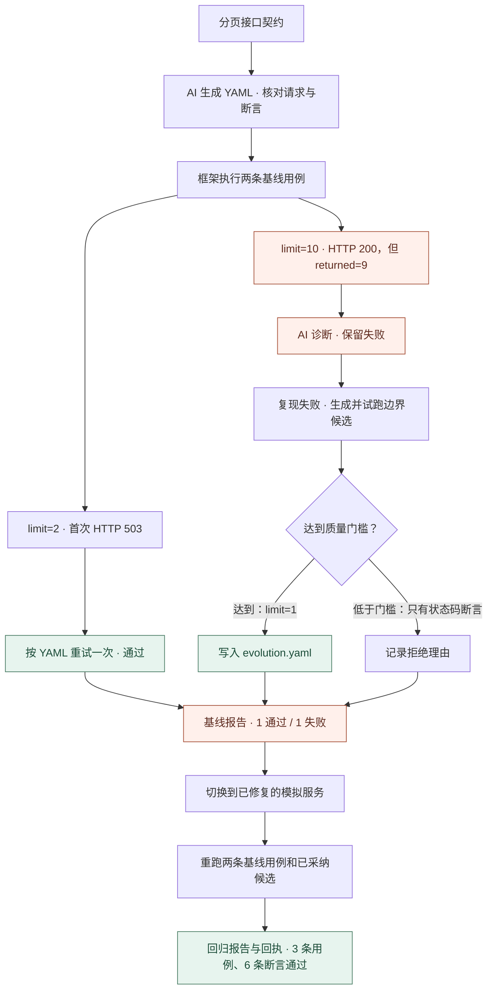

# AI 接口测试闭环示例

商品目录有 20 件商品。给定 `GET /products?limit=N`，当 `N` 在 1 到 20 之间时，接口应返回 HTTP 200 和 `{"returned": N}`。示例用这个可独立核对的契约，演示 AI 如何生成用例、解释失败并补齐边界，然后由框架执行断言和回归。

## 闭环流程图



## 一条命令跑完

在仓库根目录运行：

```bash
uv run --locked --extra dev python -m projects.demo.ai_loop
```

业务 HTTP 走 `httpx.MockTransport`，模型回复默认由框架的 `MockLLM` 回放，无需 API Key。请求发送、断言执行、重试、候选试跑、质量门控、YAML 写入和报告均经过框架。每次执行会在 `projects/demo/report/ai-loop-*/` 下创建一个新目录，终端打印绝对路径。可用 `--output-dir` 指定父目录。

示例预期看到：

```text
生成 generated.yaml，待审核=True
瞬时 503：请求 2 次，判定 passed
业务断言：{jsonpath.returned.eq} expected 10, got 9
演进：round 1: 采纳 1，拒绝 1，跳过重复 0
baseline: FAIL (1/2 通过)
regression: PASS (3/3 通过)
```

命令退出码 0 表示完整演示符合预期。第一轮的业务失败在 `baseline-receipt.json` 中仍为 `FAIL`，实际回归门禁读对应批次的回执。

## 跟着产物走一遍

| 步骤 | 示例里发生了什么 | 从哪里看 |
|---|---|---|
| 1. 从需求建用例 | `AgentNL2Case` 生成请求、状态码断言和响应字段断言。演示先对照已知契约，再写入本次运行目录。 | `data/generated.yaml` |
| 2. 执行并重试 | `limit=2` 首次收到 HTTP 503。YAML 配置 `retries: 1`，第二次请求通过。 | `data/transient.yaml`、`report/ah.log`、基线报告的 `attempts` 和 `llm_notes.retried` |
| 3. 断言报错，AI 诊断 | `limit=10` 的 HTTP 状态断言通过，`returned` 字段断言失败。回放的 `AgentTriage` 指出分页契约偏差，`FailureGovernor` 记录 `product_defect → block`，保留原失败。 | `report/baseline.html` 的用例详情、`issues/*.md` 中的复现草稿 |
| 4. 自动补测并门控 | `AutoEvolutionLoop` 复现失败，把已有用例和失败事实交给 `Predictor`。两个候选试跑均通过。只检查状态码的候选得分 0.85，低于本例门槛 0.90。检查响应数量的 `limit=1` 候选通过门控并写入演进 YAML。 | `_evolution_log.jsonl`、`data/evolution.yaml`、HTML 报告的演进与能力矩阵 |
| 5. 修复后回归 | 示例切换到已修复的模拟响应，保留原始断言，重跑两个基线用例和从 YAML 读回的新增边界。3 条用例与 6 条断言全部通过。 | `report/regression.html`、`report/regression-receipt.json` |

两个阶段均生成 HTML、Markdown、JSON 和机器可读回执。HTML 适合逐条看请求、响应、重试和失败诊断。JSON 回执包含执行状态、步骤和断言计数，以及报告和日志路径。模型运行观察位于报告的「运行分析」中。

## 用真实模型演练

配置 [模型提供商和模型 ID](../../README.md#4-按需启用-ai) 后运行。只有模型调用访问已配置的提供商，商品目录 HTTP 仍然走桩。

```bash
env -u LLMOFF uv run --locked --extra dev --extra llm python -m projects.demo.ai_loop --live-model
```

模型提供初始草案、失败诊断、补测候选和报告观察。真实模型的候选数量和分析内容可能不同。草案偏离演示契约或本轮没有候选通过并写入时，命令返回失败。默认回放用于得到固定的教学结果。

## 交给编码 Agent 的提示词

> 使用本仓库的 [API 测试 Skill](../../skills/auto-api-test-harness/SKILL.md)。先运行商品分页闭环示例，读取两个阶段的回执和演进审计。说明 503 为什么重试、HTTP 200 为什么仍失败，以及哪个候选被采纳。然后用我提供的接口契约创建 YAML 用例，并列出对应业务断言的依据。先按项目现有的离线入口执行。发生失败时保留原始证据，再诊断并生成同接口的边界候选。试跑候选，汇报保留与拒绝的原因。最后给出实际执行数、通过数、失败数、跳过或阻塞数以及报告路径。

## 其他能力怎么体验

可以跟着 [四个框架能力实操](capability-examples.md) 跑订单编排、合成 OpenAPI/HAR 建链、执行策略和失败治理，并把分页回归导入本地看板。

先跑项目原有的离线示例，再按表选一个扩展方向。分页闭环的 HTML 报告有「能力矩阵」，可以对照本轮使用的能力和对应证据。

```bash
LLMOFF=1 AH_LOCAL_OBS=0 AH_TRACE_ENABLED=0 uv run --locked --extra dev pytest -q projects/demo
```

| 能力 | 给使用者带来的价值 | 体验入口和可观察的证据 |
|---|---|---|
| 单接口、场景编排、API Skill | 用 YAML 复用登录、建单等步骤，显式处理跨步依赖 | 上面的 pytest 示例验证变量替换、响应提取、登录 token 传给下单，以及登录失败后下单被跳过。[运行说明](README.md) · [Skill 组装示例](flows/order-create.yaml) |
| 脚手架、OpenAPI 导入、依赖发现 | 用接口契约快速建项目，从调用样本发现可审核的步骤关系 | 用 `ah scaffold`、`ah openapi` 看项目和 YAML 骨架，用 `ah scenario discover/validate/compile` 看关系草案、验证和编译结果。[项目接入](../../docs/ai-api-testing.md#新建测试项目) · [依赖链实操](../../docs/operation.md#openapi-和离线依赖链) |
| 超时、软断言、属性探索 | 为接口单独配置等待和断言策略，用 seed 复现发现的异常输入 | 在离线测试看超时结果、软断言证据和固定 seed 的测试样本。[超时](../../tests/test_timeout.py) · [软断言](../../tests/test_soft_assert.py) · [属性探索](../../tests/test_property.py)（需 `prop` 依赖） |
| 失败治理、脚本自愈 | 按失败类型选择阻断、观察恢复或尝试脚本修复，保留原始失败证据 | 分页 demo 展示产品缺陷阻断。治理和自愈测试覆盖其他路径，检查分类、恢复和重跑结果。[失败治理接线](../../tests/test_failure_orchestrator.py) · [脚本自愈](../../tests/test_auto_heal.py) |
| 回归、CI 与质量分析 | 按套件和环境选取测试，用执行回执做门禁，并根据历史优先安排高风险接口 | 看 `scheduled-run` 的实际执行数和退出码，在历史风险分析中核对优先回归接口。[跑批与验收](../../docs/ai-api-testing.md#跑批与验收) · [质量检查与回归命令](../../skills/auto-api-test-harness/references/cli.md) · [风险排序](../../skills/auto-api-test-harness/references/predict.md) |
| 本地看板、追踪与模型用量 | 从整次回归下钻到请求步骤和模型调用，核对耗时、异常及用量 | 用 `ah observe seed/serve` 查看合成演示数据。真实模型模式产生的用量账本可用 `ah telemetry` 查看。[本地观察](../../docs/operation.md#本地观察与-ai-辅助) · [用量命令](../../skills/auto-api-test-harness/references/cli.md) |
| Agent 意图路由与 Laya | 把自然语言分发到生成、执行或诊断；需要时引入额外的决策信号 | 意图路由可检查匹配和缺依赖时的返回值。Laya 需单独配置，测试覆盖高置信采纳与回退。[意图调度](../../tests/test_dispatch.py) · [Laya 门控](../../tests/test_laya_gate.py) |
